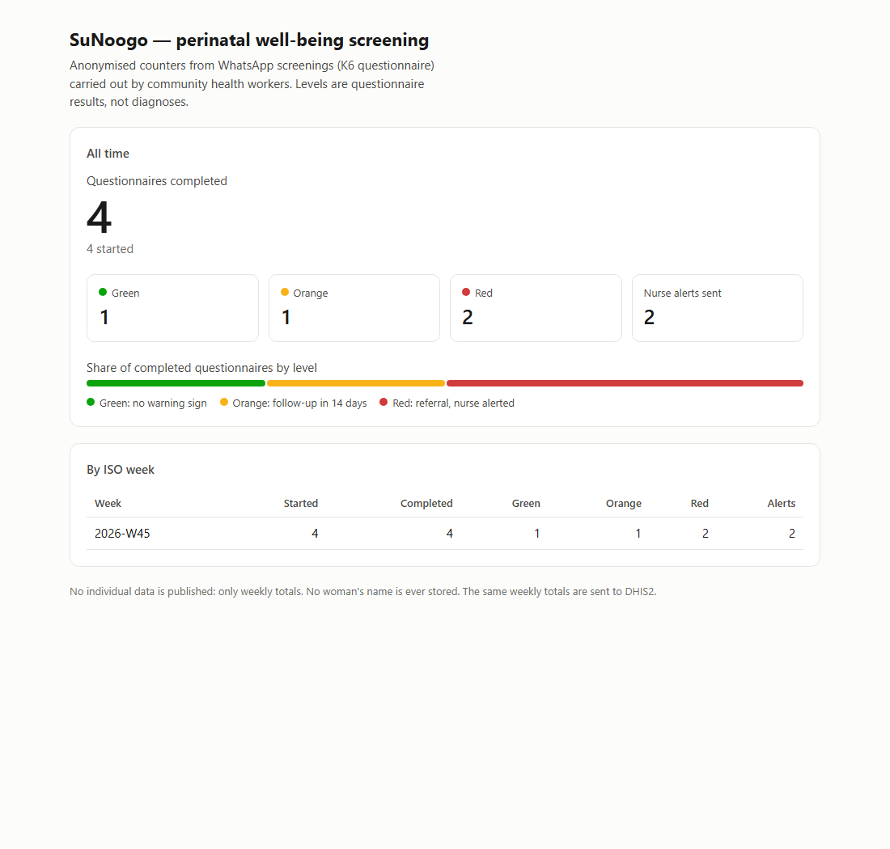

# SũNoogo

**A WhatsApp voice assistant in Mooré that helps community health workers screen pregnant and
postpartum women for psychological distress, alerts the referral nurse when a woman needs help,
and reports anonymised indicators to DHIS2.**

Community health workers (CHWs) already use WhatsApp on basic smartphones. SuNoogo turns it
into a guided screening tool: each question of the K6 questionnaire arrives as a Mooré voice
note with a short French text, the CHW types the woman's answer as a digit, and a fixed,
tested rule computes the result. High-risk results reach the nurse immediately.

> Status: working prototype (UNICEF Femtech Ventures application, November 2026).
> Not yet validated for field use — see [docs/SAFETY.md](docs/SAFETY.md).

## How a session works

```
CHW  > START F-0042                      woman identified by a code, never by name
BOT  > [audio] welcome + consent         Mooré voice note + short French text
CHW  > 1                                 1 = she agrees, 2 = she refuses (nothing stored)
BOT  > [audio] answer choices, question 1 of 6
CHW  > 1..5                              never / rarely / sometimes / most of the time / always
       ... six K6 questions ...
BOT  > [audio] safety question           thoughts of self-harm in the last 30 days?
CHW  > 1 or 2
NURSE< alert (red only, sent first)
BOT  > [audio] result: green / orange / red + what to do
BOT  > short case summary (LLM, from structured data only)
```

`STOP` ends a session at any time. An invalid answer replays the explanation of the choices and
repeats the question, without moving on.

| Level | Rule (provisional thresholds) | Action |
|---|---|---|
| Green | score 0–7, safety question negative | Routine follow-up |
| Orange | score 8–12, safety question negative | Follow-up questionnaire in 14 days |
| Red | score ≥ 13 **or** safety question positive | Immediate WhatsApp alert to the referral nurse, referral to the health centre |

### Example transcript

Produced by `python scripts/demo_session.py --scenario red-safety --no-db` with
`SUNOOGO_LANG=en` (French is the default; the nurse alert is always in French):

```
CHW   > START F-0042
BOT   > Well-being questionnaire for F-0042.
BOT   > Ask the woman whether she agrees to answer a few questions about how she feels.
        Her name is not recorded. Reply 1 if she agrees, 2 if she refuses.
CHW   > 1
BOT   > Answer each question with a digit: 1 = never, 2 = rarely, 3 = sometimes,
        4 = most of the time, 5 = all of the time.
BOT   > Question 1/6. In the last 30 days, how often did you feel nervous? (1 to 5)
CHW   > 2
  ...
BOT   > Last question. In the last 30 days, have you thought about harming yourself?
        Reply 1 = no, 2 = yes.
CHW   > 2
NURSE > ALERTE SuNoogo : résultat ROUGE au questionnaire pour F-0042. Score 3/24.
        Question de sécurité : OUI. Agent de santé : +22600000000. Merci de contacter
        l'agent dès aujourd'hui.
BOT   > Questionnaire result: RED. The referral nurse is being alerted. Refer the woman
        to the health centre as soon as possible.
BOT   > Thank you. Send START followed by a code for a new questionnaire.
```

A low score with a positive safety question is still red: the safety rule overrides the score.

### Public dashboard

Weekly anonymised totals at `/dashboard`, read only from an aggregated database view:



## Safety and privacy by design

- **The score is never computed by an LLM.** It is a fixed rule in
  [app/scoring.py](app/scoring.py), unit-tested on every possible score and threshold.
- **Positive safety question = red**, whatever the score, with an immediate nurse alert sent
  before the CHW gets the result.
- **No diagnosis in any message**: only "questionnaire result" (checked by tests).
- **No woman's name is stored.** Each woman is a code (`F-0042`); the database rejects anything
  else. Only the CHW's number is stored.
- **Nothing is stored before consent.** A refusal leaves no trace.
- **The LLM** (Claude) only writes a short summary for the CHW from the structured result; it
  receives no code, no phone number and no free text, and its output is filtered.
- **Public data is aggregated**: database tables are closed by row-level security; only a
  weekly counts view is public.

The full protocol, failure modes and known limitations are in [docs/SAFETY.md](docs/SAFETY.md).

## Architecture

```
WhatsApp (CHW phone)
   │  Meta WhatsApp Cloud API  or  Twilio WhatsApp
   ▼
FastAPI  POST /whatsapp/meta | /whatsapp ── signature check ──► flow.py (pure state machine)
   │                                             └─► scoring.py (fixed K6 rule)
   ├─► Supabase (Postgres): sessions, alerts, public_stats view
   ├─► alerts.py ──► WhatsApp alert to the referral nurse (red)
   ├─► summary.py ─► Claude API: short French summary (structured input only)
   ├─► GET /dashboard, /api/stats ─► anonymised weekly totals
   └─► dhis2.py ──► DHIS2 dataValueSets (weekly push)
```

| Path | Role |
|---|---|
| `app/flow.py` | Session state machine — pure, no I/O, fully tested |
| `app/scoring.py` | K6 score, levels and safety rule — pure, fully tested |
| `app/messages.py` | French/English texts and Mooré audio file names |
| `app/main.py` | Webhook, dashboard, static audio |
| `app/whatsapp.py` | Picks the WhatsApp provider (`WHATSAPP_PROVIDER=meta` or `twilio`) |
| `app/meta_client.py` | Sends text and voice notes through the Meta WhatsApp Cloud API |
| `app/twilio_client.py` | Sends text and audio through Twilio (audio and text are separate messages) |
| `app/db.py` | Supabase access |
| `app/alerts.py` | Nurse alert |
| `app/summary.py` | LLM case summary with output checks |
| `app/dhis2.py` | Weekly aggregation and DHIS2 push |
| `app/followups.py` | Lists due 14-day follow-ups |
| `sql/schema.sql` | Tables, constraints, row-level security, `public_stats` view |
| `scripts/demo_session.py` | Replays a full session without a phone |
| `scripts/convert_audio.py` | Converts Mooré recordings to WhatsApp voice notes (OGG/Opus, mono) |

Stack: Python 3.11+, FastAPI, Meta WhatsApp Cloud API or Twilio, Supabase (Postgres),
Anthropic API, DHIS2 Web API, pytest.

## Try it without a phone

```bash
python -m venv .venv
.venv/Scripts/python -m pip install -r requirements.txt -r requirements-dev.txt   # Windows
.venv/Scripts/python -m pytest                                                     # 258 tests
.venv/Scripts/python scripts/demo_session.py --scenario red-safety --no-db
```

Scenarios: `green`, `orange`, `red`, `red-safety`. Without `--no-db`, sessions are written to
the Supabase project configured in `.env`.

## Run the WhatsApp prototype

The same conversation logic runs on two providers. `WHATSAPP_PROVIDER` chooses which one sends
the replies:

- **`meta`: Meta WhatsApp Cloud API** (official, free test number, up to 5 registered
  recipients). This is what the prototype uses.
- **`twilio`: Twilio WhatsApp sandbox** (needs an upgraded Twilio account).

1. **Database:** create a Supabase project, paste `sql/schema.sql` into the SQL editor and run it.
2. **Configuration:** copy `.env.example` to `.env` and fill it in (never commit `.env`):

   | Variable | Purpose |
   |---|---|
   | `WHATSAPP_PROVIDER` | `meta` or `twilio` |
   | `META_ACCESS_TOKEN`, `META_PHONE_NUMBER_ID` | Meta app, *WhatsApp > API Setup* |
   | `META_APP_SECRET` | Meta app, *App settings > Basic* (checks webhook signatures) |
   | `META_VERIFY_TOKEN` | Any string, repeated in the Meta webhook settings |
   | `TWILIO_ACCOUNT_SID`, `TWILIO_AUTH_TOKEN`, `TWILIO_WHATSAPP_FROM` | Twilio account and sandbox sender |
   | `PUBLIC_BASE_URL` | Public HTTPS URL of the server (ngrok in development) |
   | `NURSE_WHATSAPP_TO` | Referral nurse, `whatsapp:+226…` |
   | `SUPABASE_URL`, `SUPABASE_SERVICE_ROLE_KEY` | Database (server-side key) |
   | `ANTHROPIC_API_KEY` | Case summary (optional) |
   | `DHIS2_BASE_URL`, `DHIS2_USERNAME`, `DHIS2_PASSWORD`, `DHIS2_ORG_UNIT` | DHIS2 instance |
   | `SUNOOGO_LANG` | `fr` (default) or `en` |

3. **Server:** `.venv/Scripts/python -m uvicorn app.main:app --port 8000`
4. **Tunnel:** `ngrok http 8000`, then put the HTTPS URL in `PUBLIC_BASE_URL` and restart the
   server.

**With Meta** (developers.facebook.com, app with the *Connect with customers through WhatsApp*
use case):

5. *WhatsApp > API Setup*: note the test number's **phone number ID**, generate an access token,
   and add the CHW and nurse phones as recipients.
6. *WhatsApp > Configuration > Webhook*: callback URL `<PUBLIC_BASE_URL>/whatsapp/meta`, verify
   token = `META_VERIFY_TOKEN`, then subscribe to the **messages** field.
7. From the CHW phone, send `START F-0042` to the test number. The nurse phone should send any
   message once first: outside a 24-hour window, Meta only delivers approved templates.

**With Twilio:**

5. Sandbox settings (legacy console, `twilio.com/console/sms/whatsapp/sandbox`): set "When a
   message comes in" to `<PUBLIC_BASE_URL>/whatsapp`, method `POST`.
6. From the CHW phone (and the nurse phone), send `join <sandbox-code>` to +1 415 523 8886,
   then send `START F-0042`.

**Mooré audio** goes in `static/audio/mos/`: `intro`, `consent`, `choices`, `q1`…`q6`, `safety`,
`result_green`, `result_orange`, `result_red`, `thanks`, `stop`, as `.ogg` (Opus codec, shown as
a voice note) or `.mp3`. A missing file is skipped and only the text is sent.
`python scripts/convert_audio.py <folder>` converts recordings named after these keys (any
format) to mono OGG/Opus voice notes.

## DHIS2 and follow-ups

```bash
python -m app.dhis2 --week 2026-W45            # push one ISO week
python -m app.dhis2 --week 2026-W45 --dry-run  # validate only
python -m app.followups                        # list orange follow-ups due today
```

The DHIS2 script creates or updates the data set **SuNoogo perinatal screening** (weekly; data
elements: sessions completed, level green, level orange, level red) and pushes the week's totals
with the `dataValueSets` API. It was tested against the public DHIS2 2.43 demo instance
(`play.dhis2.org/demo`).

## Roadmap after the prototype

Validation of thresholds and Mooré recordings with the health district, a whitelist of
registered CHW numbers, nurse acknowledgement with second-level escalation, a registered
WhatsApp Business sender with approved templates, persistent session state, and integration
with [RapidPro](https://rapidpro.io), the open-source messaging platform UNICEF uses for
U-Report, to scale across districts and channels (WhatsApp, SMS). Details in
[docs/SAFETY.md](docs/SAFETY.md#known-limitations-to-resolve-before-field-use).

## License

- Code: [MIT](LICENSE).
- Audio recordings in `static/audio/`: [CC-BY 4.0](https://creativecommons.org/licenses/by/4.0/).
  Mooré voice: Jeanne d'Arc Rayeswendé, Mooré language expert.
